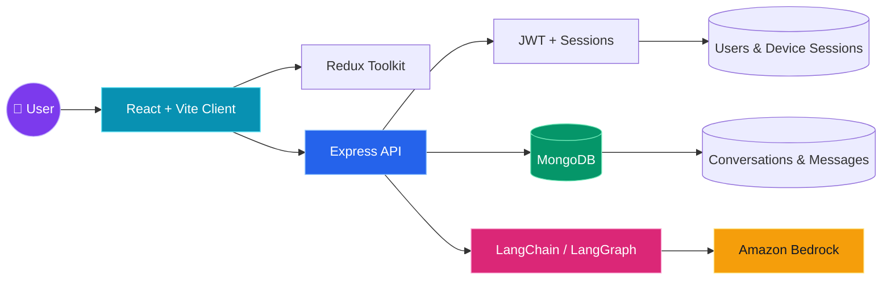

<div align="center">

# ⚡ Athena Bro

### An intelligent, full-stack AI workspace for conversations, context, and discovery.

<p>
  <a href="https://github.com/SazzzNiziyan/Athena-Bro/stargazers"></a>
  <a href="https://github.com/SazzzNiziyan/Athena-Bro/network/members"></a>
  <a href="https://github.com/SazzzNiziyan/Athena-Bro/blob/main/LICENSE"></a>
</p>

<p>
  <strong>JavaScript</strong> · <strong>React + Vite</strong> · <strong>Express</strong> · <strong>MongoDB</strong> · <strong>LangChain</strong> · <strong>Amazon Bedrock</strong>
</p>

</div>

---

## 🌌 What is Athena Bro?

**Athena Bro** is a modern AI application designed around thoughtful conversations and useful context. It combines a responsive React client with a Node.js API, persistent MongoDB data, secure authentication, and LangChain-powered model workflows.

> **Build idea:** a calm, intelligent space where users can ask questions, organize conversations, and turn AI responses into useful knowledge.

<details>
<summary><strong>✨ Explore the experience</strong></summary>

<br>

| Layer | Experience |
| --- | --- |
| 🧠 Intelligence | LangChain and LangGraph workflows with configurable Amazon Bedrock models |
| 💬 Conversations | Persistent conversations and messages with generation state, status, usage, and latency data |
| 🔐 Identity | Registration, login, refresh-token rotation, logout, and authenticated profile access |
| 🗂️ Organization | Conversation titles, ownership references, search/share indexes, and model metadata |
| ⚡ Interface | React 19, Vite, Redux Toolkit, React Router, Markdown rendering, and syntax highlighting |

</details>

## 🛰️ System constellation



## 🎥 Screenshots, GIFs, and live demo

> The repository does not currently include screenshot or GIF assets, and no deployed demo URL has been configured yet. Add real media files to `docs/media/` and replace the placeholders below when they are available.

### 🖼️ Product preview

| Conversation workspace | Authentication flow |
| --- | --- |
|  |  |

### ✨ Interactive walkthrough


### 🌐 Live demo

<div align="center">

[](https://github.com/SazzzNiziyan/Athena-Bro)

</div>

The live-demo button currently links to this repository until a hosted frontend is available. For a local interactive preview:

```bash
cd frontend
npm install
npm run dev
```

Then open the Vite URL shown in your terminal.

<details>
<summary><strong>How to add media</strong></summary>

1. Create a `docs/media/` directory.
2. Add optimized `.png`, `.webp`, or `.gif` files.
3. Use descriptive names such as `conversation-workspace.png` and `athena-bro-walkthrough.gif`.
4. Replace the live-demo URL with the deployed frontend URL.
5. Keep sensitive data, API keys, tokens, and private conversations out of screenshots.

</details>

## 🧩 Core capabilities

### 🔐 Secure authentication

- Password hashing with `bcryptjs`
- Short-lived access tokens with JWT
- HTTP-only refresh cookies
- Refresh-token rotation and device session persistence
- Protected `/me`, refresh, and logout flows
- Request validation with `express-validator` and `zod`

### 🧠 AI conversation engine

- LangChain and LangGraph integration
- Configurable Amazon Bedrock model selection
- Allow-listed model configuration
- Conversation-first message persistence
- Generation status, usage, and latency tracking
- Markdown and code rendering in the client

### 🎛️ Interactive frontend foundation

- React 19 + Vite development workflow
- Redux Toolkit state management
- React Router navigation
- Axios API communication
- Markdown with GitHub-Flavored Markdown support
- Syntax highlighting for technical answers
- Lucide icons for a polished interface

## 🗺️ Project map

```text
Athena-Bro/
├── backend/
│   ├── src/
│   │   ├── DAO/              # Data-access helpers
│   │   ├── models/           # User, session, conversation, message models
│   │   ├── routes/           # API route definitions
│   │   └── server.js         # API entry point
│   ├── .env.example
│   └── package.json
├── frontend/
│   ├── src/                  # React application
│   ├── public/               # Static assets
│   └── package.json
├── package.json              # Root AI/workflow dependencies
└── README.md
```

## 🚀 Quick start

### Prerequisites

- **Node.js 20+**
- **MongoDB** running locally or through a hosted provider
- An **Amazon Web Services** account with Amazon Bedrock access
- Credentials configured for the Bedrock models you intend to use

### 1. Clone the project

```bash
git clone https://github.com/SazzzNiziyan/Athena-Bro.git
cd Athena-Bro
```

### 2. Configure the backend

```bash
cd backend
npm install
cp .env.example .env
```

Set distinct random values for `ACCESS_TOKEN_SECRET` and `REFRESH_TOKEN_SECRET`, then configure MongoDB and Bedrock settings in `.env`.

### 3. Start the API

```bash
npm run dev
```

The backend listens on port `5001` by default.

### 4. Start the frontend

Open a second terminal:

```bash
cd frontend
npm install
npm run dev
```

Vite will print the local development URL in the terminal.

## 🔌 Authentication API

Base path: `/api/v1/auth`

| Method | Endpoint | Purpose |
| :---: | --- | --- |
| `POST` | `/register` | Create an account and issue an access token |
| `POST` | `/login` | Authenticate a user and issue an access token |
| `POST` | `/refresh` | Rotate the refresh-token pair |
| `POST` | `/logout` | Revoke the current persisted session |
| `GET` | `/me` | Return the authenticated public user |

<details>
<summary><strong>Example registration payload</strong></summary>

```json
{
  "name": "Ada Lovelace",
  "email": "ada@example.com",
  "password": "analytical123"
}
```

</details>

<details>
<summary><strong>Example success response</strong></summary>

```json
{
  "success": true,
  "message": "Registration successful",
  "data": {
    "accessToken": "<access-token>",
    "user": {
      "name": "Ada Lovelace",
      "email": "ada@example.com"
    }
  }
}
```

</details>

## ⚙️ Useful commands

| Directory | Command | Description |
| --- | --- | --- |
| `backend` | `npm run dev` | Start the API with Node watch mode |
| `backend` | `npm start` | Start the API normally |
| `frontend` | `npm run dev` | Start the Vite development server |
| `frontend` | `npm run build` | Create a production frontend build |
| `frontend` | `npm run lint` | Run Oxlint |
| `frontend` | `npm run preview` | Preview the production build locally |

## 🔑 Environment checklist

Use `backend/.env.example` as the source of truth for available variables. At minimum, configure:

- `MONGODB_URI`
- `ACCESS_TOKEN_SECRET`
- `REFRESH_TOKEN_SECRET`
- `BEDROCK_DEFAULT_MODEL`
- `BEDROCK_MODEL_ALLOW_LIST`
- AWS credentials or an equivalent AWS credential-provider setup

> Never commit real secrets, access keys, refresh tokens, or production connection strings.

## 🧭 Development principles

1. **Persist intent before generation** — save the first user message before starting a model response.
2. **Keep identity secure** — hash passwords, rotate refresh tokens, and revoke sessions explicitly.
3. **Make model behavior configurable** — use an allow-list instead of accepting arbitrary model IDs.
4. **Return predictable responses** — use consistent `success`, `message`, `data`, and `errors` fields.
5. **Keep the interface readable** — render markdown, code, and long-form answers with clear hierarchy.

## 📚 Documentation

- [Backend API notes](backend/README.md)
- [Frontend setup notes](frontend/README.md)
- [GitHub repository](https://github.com/SazzzNiziyan/Athena-Bro)

## 🤝 Contributing

Ideas, bug reports, and improvements are welcome. Create a focused branch, explain the change clearly, and open a pull request with the relevant verification steps.

```bash
git checkout -b feature/your-improvement
git commit -m "feat: describe your improvement"
git push origin feature/your-improvement
```

## 📄 License

No license has been declared in the repository yet. Add a `LICENSE` file before distributing Athena Bro or accepting external contributions under a specific license.

<div align="center">

### Made with curiosity, code, and a little cosmic energy ✨

<sub>Athena Bro · intelligent conversations for a more thoughtful web</sub>

</div>
